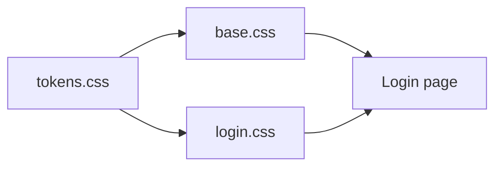

# Login UI and global design tokens

The README defines a pre-login auth zone at `/auth/login` inside [auth-layout](src/app/layouts/auth-layout/auth-layout.html), which is only a `<router-outlet>`. [login.html](src/app/features/auth/login/login.html) is still the CLI placeholder (`login works!`), and [styles.css](src/styles.css) is empty. Login TypeScript stays untouched: this pass is markup and CSS only, with no form logic, signals, or API calls.

Production component styles are capped at 8kB in [angular.json](angular.json), so shared primitives live in global CSS. The login stylesheet stays a thin layout file.

## Design direction

Transit administration, not a consumer ticket shop: deep ink navy, warm paper surfaces, and a single amber accent for the primary action. Typography is Outfit for UI and Newsreader for the brand line, loaded from Google Fonts in [index.html](src/index.html).

## Global files

- **[src/styles/tokens.css](src/styles/tokens.css)** — CSS custom properties only, grouped for later screens (dashboard, vendors, schedules, bookings):
  - Color: ink and paper scales, amber brand, semantic success / warning / danger / info, text, border, overlay
  - Type: families, size steps, weights, line-height, tracking
  - Space scale, radii, shadows, motion, z-index
  - Layout tokens the admin shell will need later: header height, sidenav width, content max width, control heights
- **[src/styles/base.css](src/styles/base.css)** — reset, body defaults, headings, links, focus ring, and reusable primitives that read the tokens: `.btn`, `.btn-primary`, `.btn-ghost`, `.field`, `.label`, `.input`, `.hint`
- **[src/styles.css](src/styles.css)** — `@import` tokens, then base. No extra entry in `angular.json`.

## Login screen

Update [login.html](src/app/features/auth/login/login.html) and [login.css](src/app/features/auth/login/login.css) only.

Full-viewport split:

- **Left panel:** wordmark, short portal line (“Bus Booking Administration”), and a short list of what the workspace covers (vendors, routes, schedules, bookings). Decorative route lines are CSS, no images.
- **Right panel:** sign-in card with email, password, remember-me, a forgot-password text link, and a primary “Sign in” button. A register prompt links visually to `/auth/register` (that route is not wired yet; the link is presentational).

Native `<form>` and inputs only. The submit control is `type="button"` so the page does not navigate or post. No Angular directives, and [login.ts](src/app/features/auth/login/login.ts) is left as-is.

The layout stacks to a single column under 900px: brand block on top, form below.

## Browser check

Dev server is already running. After the styles land, open `/auth/login`, confirm the split layout, type in both fields, tab through focus states, and check a narrow viewport. The button must not leave the page.
